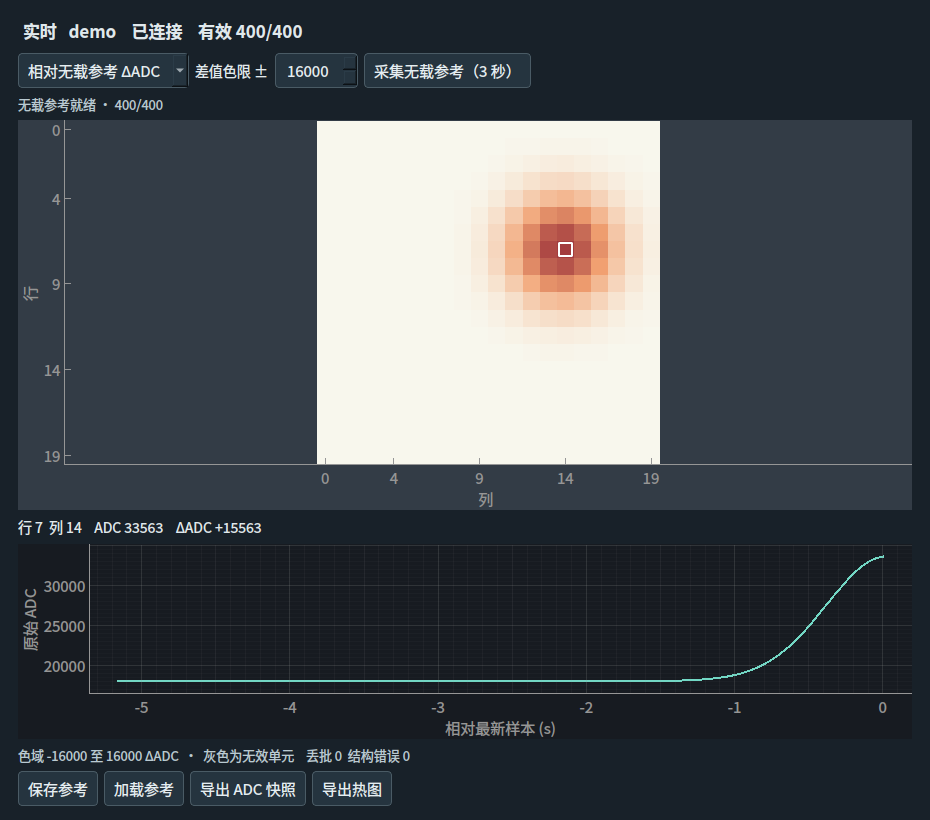

# griptile_driver

适用于单块 USB 串口夹爪触觉阵列的 ROS 2 驱动和二维查看器。连接指定串口后即可查看 20×20 个单元的原始 ADC，点击单元可观察接触和释放时的读数变化。查看器、录制器与其他 ROS 节点可以同时订阅同一驱动。[English guide](docs/README.en.md)



## 构建

环境为 Ubuntu 24.04、ROS 2 Jazzy、colcon 和已初始化的 rosdep。在仓库根目录运行以下命令。

```bash
source /opt/ros/jazzy/setup.bash
rosdep install --from-paths src --ignore-src --rosdistro jazzy -y
colcon build --base-paths src
source install/setup.bash
```

每个新终端先加载上述两个 setup.bash。只部署采集节点的主机可以将 rosdep 的包目录设为 `--from-paths src/griptile_{core,msgs,driver}`，并给 colcon 增加 `--packages-up-to griptile_driver`，启动参数 `gui` 默认关闭。

## 打开二维查看器

没有硬件时，从仓库根目录启动模拟器。演示通过专用虚拟串口运行完整驱动，话题位于 `/tactile/demo`。按 Ctrl+C 退出。

```bash
python3 examples/demo.py
```

使用夹爪时，把下面的端口换成操作系统中这块阵列对应的路径。建议选用 `/dev/serial/by-id/` 中稳定的设备链接。默认波特率为 115200。同一块板由一个驱动进程打开，多个应用可订阅它的话题。

```bash
ros2 launch griptile_driver sensor.launch.py port:=/dev/ttyUSB0 gui:=true
```

窗口的行列编号从 0 到 19。原始模式可直接使用，灰色单元表示当前缺少有效测量。需要观察相对变化时，让阵列保持无载并点击「采集无载参考（3 秒）」，完成后显示有符号的 ΔADC。窗口可导出单元快照 CSV 与热图 PNG。能识别设备 USB 身份时，还能保存参考供同一设备和布局再次使用。设备的夹持力和压力单位需要独立的物理标定。

## ROS 接口与时间

默认命名空间为 `/tactile/sensor_0`。启动时可使用 `sensor_id:=jaw_a` 指定传感器逻辑名称，对应默认命名空间 `/tactile/jaw_a`。

| 相对话题 | 消息 | 用途 |
| --- | --- | --- |
| `samples` | `griptile_msgs/msg/TactileRow44Array` | 按串口顺序保存的 ADC 行、主机接收时刻、序号和丢批计数。推荐作为录制输入 |
| `info` | `griptile_msgs/msg/SensorInfo` | 协议、布局、单位、当前连接及可用的设备标识。支持晚加入的订阅者 |
| `state` | `griptile_msgs/msg/TactileGridState` | 供显示的滚动阵列，含逐行时间、有效掩码和更新掩码。默认 30 Hz |
| `diagnostics` | `diagnostic_msgs/msg/DiagnosticArray` | 观察连接、数据龄期、丢批和结构错误 |
| `heatmap` | `sensor_msgs/msg/Image` | 可选 RGB 预览，通过 `publish_heatmap:=true` 启用 |

每行 44 字节，由帧头 `A5 5A`、一个大端 16 位行号和 20 个大端 16 位 ADC 值组成。协议无已知校验和、硬件时间戳或硬件序号。源时间来自串口读取完成的主机时钟。矩阵由先后收到的行组成，默认超过 100 ms 的行会标记过期。处理算法应同时读取 `adc` 和 `valid_mask`，零本身是合法读数。

## 录制与回放

在默认传感器运行时，从另一终端录制采样和设备信息。待录制器显示已订阅后开始采集，按 Ctrl+C 完成保存。自定义命名空间时，同时修改话题名称和 QoS 文件中的键。

```bash
qos="$(ros2 pkg prefix --share griptile_driver)/config/record_qos.yaml"
ros2 bag record -s mcap -o grip_run --qos-profile-overrides-path "$qos" \
  --topics /tactile/sensor_0/samples /tactile/sensor_0/info
```

停止该采集驱动，在一个终端启动回放窗口，再在另一个终端播放刚录好的包。重建的阵列位于 `/tactile/replay/state`。播放结束后，只要回放节点仍在运行，新打开的查看器也能通过 `/tactile/replay/info` 获取原传感器信息。录制时若修改过 `max_cell_age_ms`，回放时传入相同的值即可复用相同的过期判断。

```bash
ros2 launch griptile_driver replay.launch.py gui:=true
```

```bash
ros2 bag play grip_run --clock 100 --delay 1
```

若录制的传感器名为 `jaw_a`，回放启动命令也要增加 `sensor_id:=jaw_a`。若录制时还单独指定了命名空间，例如 `/robot/jaw`，同时增加 `source_namespace:=/robot/jaw`。

## 验证与维护

```bash
QT_QPA_PLATFORM=offscreen python3 -m pytest -q --import-mode=importlib src/*/test tests
python3 scripts/compare_wire.py
```

测试会通过虚拟串口向正式节点供数，录制 MCAP，再从行采样重建阵列。默认输入是确定性生成的样例。设置 `GRIPTILE_WIRE` 可用自己的完整、行对齐的 44 字节协议记录运行 `tests/test_sample_roundtrip.py`。离线对照工具接受 `--wire` 和可选的 `--baseline-source`，用于对照含指定版本的旧工程。

已使用一段 41,932 字节的历史记录对照提取前后的实现。953 行文件解析相同；通过虚拟串口重录的 19,060 个 ADC 值逐项吻合，回放重建的 400 个单元、有效位和行时间与采集端一致。实时解析器使用下一行帧头确认上一行，文件自然结束时最后 44 字节保持待确认。本次串口验收额外送入 4 字节下一帧头，让最后一行参与比较。历史文件保存了字节顺序，原始 USB 到达间隔未被记录。这项验证覆盖数据链路，实体夹爪的安装朝向、受力响应和持续运行需另行实测。公开仓库提供合成样例和验证摘要。[新旧对照结果](tests/evidence/wire-parity.json) · [ROS 录制回放结果](tests/evidence/wire-ros-roundtrip.json)

| 包 | 职责 |
| --- | --- |
| `griptile_core` | 串口访问、行协议解析、逐行时间和有效性、无载参考 |
| `griptile_msgs` | 采样、阵列状态与设备信息的 ROS 消息定义 |
| `griptile_driver` | 采集、诊断、录制配置与回放节点 |
| `griptile_viewer` | 订阅 ROS 消息，显示与导出二维阵列 |

采集内核源自 VisionTactile-Dataset 的 `vt_tactile_capture`，提取基线为 `74e861c23aa54d104503c6e521d739ec25163c2b`。本项目延用 Apache-2.0 许可证，可在独立工作区构建与安装。[许可证](LICENSE)
