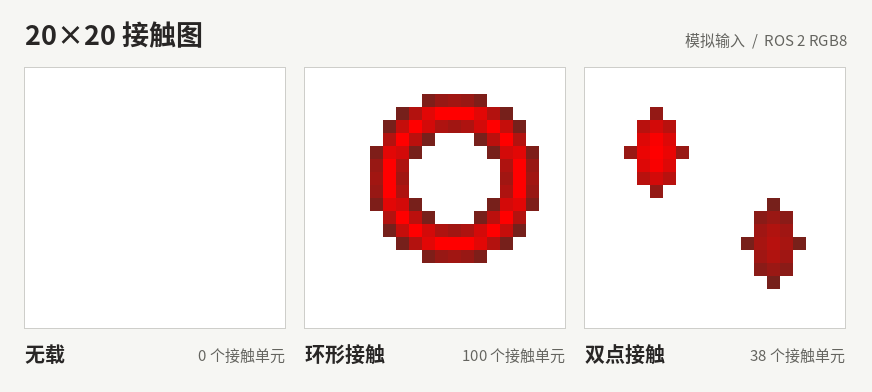
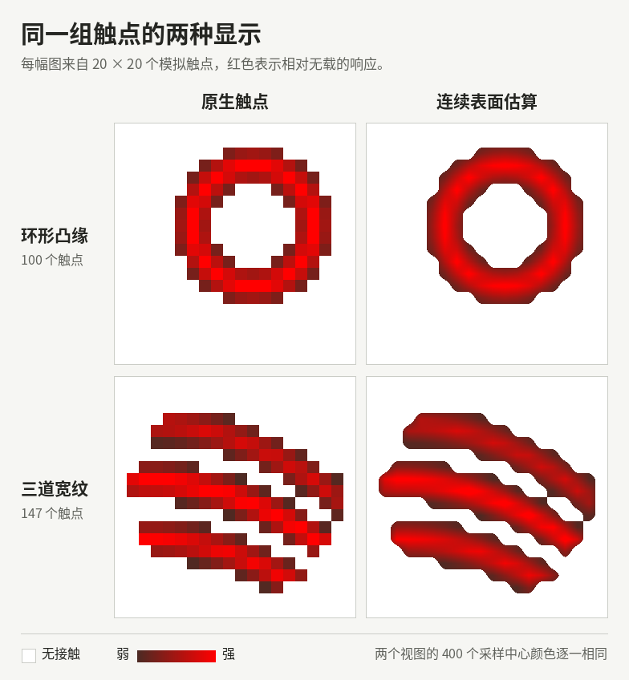

# griptile_driver

A ROS 2 driver and a 2D viewer for one USB serial gripper tactile array. Each taxel maps to one RGB pixel. See where the gripper touches an object, how many cells respond and how response varies across its contact footprint. The driver owns the serial device and ROS subscribers share its output. [中文说明](../README.md)



[Native 20×20 RGB example](contact-ring.png) · [Qt window](viewer-demo.png)

## Build and run

Use Ubuntu 24.04 with ROS 2 Jazzy, colcon and initialized rosdep. Run these commands from the repository root.

```bash
source /opt/ros/jazzy/setup.bash
rosdep install --from-paths src --ignore-src --rosdistro jazzy -y
colcon build --base-paths src
source install/setup.bash
```

Source both setup files in each new terminal. Run the full driver and viewer on a simulated sensor without hardware. Press Ctrl+C to stop.

```bash
python3 examples/demo.py
```

For a real sensor, substitute its serial path below. A stable symlink under `/dev/serial/by-id/` is preferable when available. Default baud rate is 115200. The driver opens only the supplied port. Omit `gui:=true` for headless acquisition. On a headless machine, use `--from-paths src/griptile_{core,msgs,driver}` for rosdep and build with `colcon build --base-paths src --packages-up-to griptile_driver`.

```bash
ros2 launch griptile_driver sensor.launch.py port:=/dev/ttyUSB0 gui:=true
```

The default contact view uses row and column addresses 0–19, with row zero at the top and column zero at the left. Open the gripper, unload the surface and click the three-second reference button. Once the reference is ready, white pixels indicate measured cells with no detected contact. Weak contacts appear dark reddish brown and progress to saturated red. Gray pixels indicate missing reference or stale data. The demo supplies unloaded samples until the driver confirms the reference, then cycles through a ring, release and two separate contact patches.

The native **接触图 RGB** view magnifies the pixels with nearest-neighbor sampling. Contact-mode PNG export writes the original 20×20 RGB image. The contact footprint counts responding cells; conversion to physical area requires sensor dimensions. Intensity is a noise-gated ADC change; force or pressure units require physical calibration. Raw ADC and signed delta views, per-cell traces and CSV export remain available. Saved references can be reused with a verified matching device and layout.

The default **连续接触面（估算）** view displays the same 400 taxels as a 300×300 RGB surface. The viewer interpolates noise-gated ADC amplitudes between neighboring taxel centers and estimates the contact outline from their active flags. Unknown regions stay gray. Colors at all 400 measured centers match the native grid. Picking, time series and contact counts still use the original addresses. The surface view exports a 300×300 PNG. Both views share the same unloaded reference.



The color scale is fixed across frames. The default full red response is 3000 ADC counts. Set `contact_span_adc:=6000.0` to extend the range. The default `contact_direction:=both` accepts either sign of ADC change. Select `increase` or `decrease` when the pressure polarity is known. All subscribers share the driver's calibration. From a headless terminal with the gripper unloaded, request it with the command below.

```bash
ros2 service call /tactile/sensor_0/set_contact_reference griptile_msgs/srv/SetContactReference '{}'
```

## ROS interfaces

The default namespace is `/tactile/sensor_0`. Set a different logical ID with `sensor_id:=jaw_a` to use `/tactile/jaw_a`. The demo runs in `/tactile/demo`.

| Topic | Type | Data |
| --- | --- | --- |
| `samples` | `griptile_msgs/msg/TactileRow44Array` | Decoded ADC rows in wire order, host read times, software sequence numbers and loss counters. Record this stream |
| `info` | `griptile_msgs/msg/SensorInfo` | Protocol, layout, units and available device identity. Uses reliable transient-local QoS |
| `state` | `griptile_msgs/msg/TactileGridState` | Rolling array, row times, valid and updated masks. Defaults to 30 Hz |
| `diagnostics` | `diagnostic_msgs/msg/DiagnosticArray` | Connection, freshness, dropped batches and framing errors |
| `contact_image` | `sensor_msgs/msg/Image` | Native 20×20 RGB8 contact image, 60 bytes per row, source header preserved |
| `contact_response` | `sensor_msgs/msg/Image` | Native 20×20 `32FC1` noise-gated ADC amplitudes, paired to the RGB image by its acquisition header. Zero indicates inactive, NaN indicates unknown. Values above the display range are retained |
| `contact_reference` | `griptile_msgs/msg/ContactReference` | Reference progress, session and device binding, ready coefficients, direction and display range. Transient-local |
| `heatmap` | `sensor_msgs/msg/Image` | Optional raw ADC color preview. Enable with `publish_heatmap:=true` |

A 44-byte packet has a two-byte `A5 5A` header, a big-endian uint16 row index and twenty big-endian uint16 ADC values. The protocol has no documented checksum, device timestamp or hardware sequence counter. Samples use host read-completion times. A grid combines sequential row updates and uses a 100 ms default freshness limit. Read the validity mask alongside ADC values. Zero can be a valid measurement.

## Record and replay

With the default driver running, start the recorder in another terminal, wait for the subscriptions and press Ctrl+C to finish recording. For a custom namespace, update both topic names and the corresponding YAML keys.

```bash
qos="$(ros2 pkg prefix --share griptile_driver)/config/record_qos.yaml"
ros2 bag record -s mcap -o grip_run --qos-profile-overrides-path "$qos" \
  --topics /tactile/sensor_0/samples /tactile/sensor_0/info /tactile/sensor_0/contact_reference
```

Stop the live driver, launch the replay node and viewer in one terminal, then play the bag from another. The reconstructed array is published on `/tactile/replay/state`. While the replay node remains running, late subscribers can read the original sensor metadata on `/tactile/replay/info` after the player exits. If live acquisition used a custom `max_cell_age_ms`, set the same value on replay to apply the same freshness policy.

```bash
ros2 launch griptile_driver replay.launch.py gui:=true
```

```bash
ros2 bag play grip_run --clock 100 --delay 1
```

The replay node uses recorded references on the matching acquisition session to reconstruct `/tactile/replay/contact_image`. Older bags without a reference can display raw ADC. To create a reference during replay, use a known unloaded interval. To preserve the exact RGB frames as originally published, also record `/tactile/sensor_0/contact_image` and view that original topic during playback.

To replay a recording made with `sensor_id:=jaw_a`, pass that same argument to the replay launch. If you also used a custom namespace such as `/robot/jaw`, add `source_namespace:=/robot/jaw`.

## Verification

```bash
QT_QPA_PLATFORM=offscreen python3 -m pytest -q --import-mode=importlib src/*/test tests
python3 scripts/compare_wire.py
```

Tests cover decoding, fragmented input, rolling state, serial connection boundaries, ROS messages, Qt and an end-to-end MCAP round trip through a virtual serial port. CI uses generated data. Set `GRIPTILE_WIRE` to a complete, row-aligned row44 capture to exercise `tests/test_sample_roundtrip.py` with your own bytes. The offline comparison script accepts `--wire` and optionally `--baseline-source` pointing to a trusted checkout containing the pinned upstream commit.

A 41,932-byte archived sensor trace contained 953 rows. File decoding matched the previous implementation. All 19,060 ADC values survived recording through the installed driver. The replayed 400-cell grid, valid mask and row timestamps matched acquisition. The live parser confirms a row on receiving the next header, so an unextended file leaves the final 44 bytes pending. The round-trip test supplies four extra header bytes to confirm that row. The archived input preserves byte order but lacks the original USB arrival times. The checked-in reports cover the software path. Gripper mounting orientation, mechanical response and endurance require physical testing. [Extraction comparison](../tests/evidence/wire-parity.json) · [ROS round trip](../tests/evidence/wire-ros-roundtrip.json)

## Package layout

| Package | Responsibility |
| --- | --- |
| `griptile_core` | Serial access, wire decoding, row timing and freshness, unloaded reference |
| `griptile_msgs` | ROS 2 sample, state and metadata message definitions |
| `griptile_driver` | Live acquisition, diagnostics, recording configuration and replay |
| `griptile_viewer` | Standalone Qt subscriber for matrix inspection and export |

The acquisition core derives from VisionTactile-Dataset's `vt_tactile_capture` at commit `74e861c23aa54d104503c6e521d739ec25163c2b`. This workspace builds and runs independently. [Apache-2.0 license](../LICENSE)
