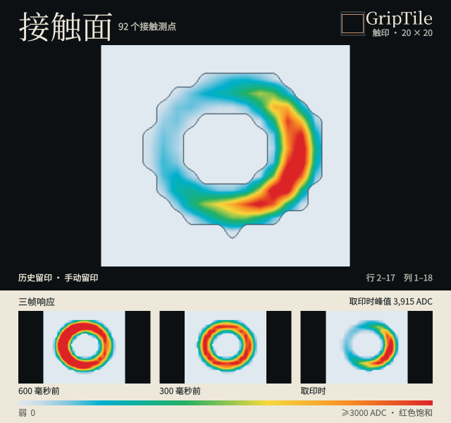

# griptile_driver

A ROS 2 driver and a 2D viewer for one USB serial gripper tactile array. Each taxel maps to one RGB pixel. See where the gripper touches an object, how many cells respond and how response varies across its contact footprint. The driver owns the serial device and ROS subscribers share its output. [中文说明](../README.md)


[Native 20×20 RGB example](contact-ring.png) · [Qt window](viewer-demo.png)

## Build and run

Use Ubuntu 24.04 with ROS 2 Jazzy, colcon and initialized rosdep. Run these commands from the repository root.

```bash
source /opt/ros/jazzy/setup.bash
rosdep install --from-paths src --ignore-src --rosdistro jazzy -y
colcon build --base-paths src
source install/setup.bash
```

Source both setup files in each new terminal. Run the full driver and viewer on a simulated sensor without hardware. Press Ctrl+C to stop.

```bash
python3 examples/demo.py
```

To use a physical array, launch the driver and viewer, open **串口设置** (Serial settings), choose a device on the acquisition host or type its path, and click **连接** (Connect). The default baud rate is 115200. The dialog lists Linux by-id aliases when available and distinguishes an open port from a sensor streaming valid data. [Serial settings window](serial-settings.png)

```bash
ros2 launch griptile_driver sensor.launch.py gui:=true
```

The dialog can refresh the list, switch ports and disconnect. Changing connections starts a new acquisition session. You can also select a port at startup with `port:=/dev/ttyUSB0 baudrate:=115200`. Omit `gui:=true` for headless acquisition. On a headless installation use `--from-paths src/griptile_{core,msgs,driver}` with rosdep and build with `colcon build --base-paths src --packages-up-to griptile_driver`.

Expand **详情** for view selection, cell traces and exports. The array uses row and column addresses 0–19, with row zero at the top and column zero at the left. Open the gripper, unload the surface and click the three-second reference button. Once the reference is ready, light blue-gray pixels indicate measured cells with no detected contact. The first positive color step is one RGB code from the background. Increasing response moves through pale blue to cyan at 20% of the display span, then green, yellow, orange and red. Gray pixels indicate missing reference or stale data. The demo supplies unloaded samples until the driver confirms the reference, then cycles through a ring, release and two separate contact patches.

The live viewer uses source-matched scalar responses to color both contact views. Archived RGB images retain their original colors. [Compare the same inputs from zero to light contact](contact-onset.png).

The native **接触图 RGB** view magnifies the pixels with nearest-neighbor sampling. Contact-mode PNG export writes the original 20×20 RGB image. The contact footprint counts responding cells; conversion to physical area requires sensor dimensions. Intensity is a noise-gated ADC change; force or pressure units require physical calibration. Raw ADC and signed delta views, per-cell traces and CSV export remain available. Saved references can be reused with a verified matching device and layout.

The live window opens on a square **连续接触面（估算）** display with its fixed color scale. The peak readout gives the strongest available taxel response as a percentage of the display span. A driver with a ready unloaded reference can be used immediately. The surface renders the same 400 taxels at 300×300 RGB. The viewer interpolates noise-gated ADC amplitudes between neighboring taxel centers and estimates the contact outline from their active flags. Unknown regions stay gray. Colors at all 400 measured centers match the native grid. Picking and time series use the original addresses. The response count includes every taxel with a positive response, including weak signals. The surface view exports a 300×300 PNG. Both views share the same unloaded reference.

**详情 → 接触轮廓** (Contact outline) defaults to on. Thin lines trace the supported outer edges and holes on the continuous surface. On each frame, cells reaching eight times their individual unloaded activation thresholds seed a region. The region extends through four-connected cells reaching twice their own thresholds. Weak isolated touches still appear in the underlying color image. Boundaries stay open next to missing measurements. PNG exports contain the original color image. [Live viewer example](viewer-demo.png)


The three RGB channels encode one tactile response per taxel. The same response always receives the same color across frames. The red endpoint defaults to 3000 noise-gated ADC counts. Set `contact_span_adc:=6000.0` to extend the range. The default `contact_direction:=both` accepts either sign of ADC change. Select `increase` or `decrease` when the pressure polarity is known. All subscribers share the driver's unloaded reference. From a headless terminal with the gripper unloaded, request it with the command below.

```bash
ros2 service call /tactile/sensor_0/set_contact_reference griptile_msgs/srv/SetContactReference '{}'
```

### See the shape of the contact footprint

Click **触印** beside the GripTile name. The large image shows the current contact footprint as soon as the first contact is observed. A boundary traces the outer edges and supported holes of each patch. Color inside the footprint shows the local response. Separate patches and gaps remain visible. A footprint reaching the edge of the sensor is clipped there. Clear **放大接触区** to locate it on the full array.

Once sufficient observations are available, three color panels show the responses about 600 ms ago, 300 ms ago and at the latest sample, with the same crop and color scale. These panels include weak readings outside the detected footprint and help explain how its shape and strength change during loading and release.

Each print stores the display span from its acquisition. Responses above that span stay red, while the peak readout retains the last exposure's actual ADC response. The known-load workflow provides a separate force estimate in newtons.

Use the existing unloaded reference. A taxel reaching eight times its own threshold seeds a patch and continues to be tracked down to twice that threshold. Side-adjacent taxels at or above twice their own thresholds extend that footprint in the current frame. The boundary is interpolated between measured points. Equalization affects the displayed colors. The count describes native taxels included in the footprint. A complete observation with no tracked contact clears the live image immediately. A data gap displays a waiting state.

During contact, **拍下当前** takes a manual print once about 0.6 seconds of continuous readings are available. Following sustained contact, 0.3 seconds below the release threshold confirms an automatic print from the decline. Select **上次留印** to review and export the saved print with its exposures and legend. The live view stays current when a print is saved. Automatic capture also works with the print window closed.

The live viewer matches the native 20×20 scalar response to its source state and labels prints made with active taxel equalization. Standard bag replay reconstructs the scalar response from samples and the recorded reference. Interpolated contours visualize the footprint between measured points. The ROS `state` and `contact_response` topics supply native data for quantitative analysis and CV.



### Match taxel colors under equal local pressure

Open **阵元标定** in the live viewer and reuse the ready unloaded reference. Cover the entire 20×20 array with a uniform-pressure bladder or a fixture with independently established pressure uniformity. Keep the mounting and contact surface fixed. A cap rim, finger or total force reading alone cannot establish equal local pressure.

1. Apply a lower uniform pressure, let it settle, click **采集第一档**, and hold for about one second. This determines a sensitivity factor for each taxel.
2. Increase pressure across the face. Once steady, click **采集验证档**. This independent check requires at least a 25% higher median response and reports the spread across all 400 taxels before and after correction, plus the largest corrected deviation.
3. Click **保存并启用** to adopt the validated result. With an unverified USB identity, **本次连接启用** applies it for the current connection. Saved gains can be reused with matching hardware, layout, response direction and unloaded reference. Reopen the dialog to disable, enable or remove them.

No pressure values need to be entered. The corrected spatial coefficient of variation (standard deviation divided by mean) must be at most 10% and each corrected taxel must be within 20% of the median. The dialog identifies weak, saturated or unstable cells and allows retrying the check independently. A consistently uneven fixture can reproduce the same pressure pattern at both levels and bias the calibration.

The factors adjust colors in both live contact views and the main peak indicator around the validated range. Raw ADC, ROS response and RGB topics, PNGs exported from the main viewer's details panel and the force-gauge workflow retain the original scale. The details panel labels its PNG export **导出未均衡图** while correction is active. [Two-level validation on a simulated array](taxel-calibration.png)

### Check the display against a known load

Align a force gauge with the normal to the sensing face and keep the indenter and its position fixed. Open **已知载荷验证** in the live viewer. Reuse the current unloaded reference, or acquire one with the jaw open. Enter two gauge readings in newtons, a lower independent check load and a higher calibration load.

| Hold | Gauge reading | Use |
| --- | --- | --- |
| Load up | Lower check load | Independent reading during clamping |
| Load further | Higher calibration load | Fit a single gain using this point and the existing zero |
| Unload partway | Same lower check load | Check the estimate on unloading against the gauge and the loading reading |
| Release | Zero | Measure the residual after release |

Follow the single action shown for each step and capture when the gauge reaches the target. The high calibration load requires a stable hold. Independent checks retain the first complete measurement window and its variation, including fluctuations on release. A gap in acquisition restarts the current sampling window. The window estimates total normal force on this sensor face from the sum of the 400 native noise-gated responses. The RGB image keeps its ADC scale. A cell above the red endpoint still contributes its full response to the force estimate. The gain is local to this setup. Accuracy between the two fit endpoints must be tested independently. A per-cell pressure scale in kPa requires additional calibration.

The result compares the two peak colors and force estimates at the same gauge reading and shows the residual after release. Open the details to inspect individual signed errors and export the JSON report. To compare locations or indenters, apply the same check load and use **同载荷复测**. Every repeat uses the original gain. With the default bidirectional contact detector, reverse electrical excursions can also show up as contact on release. The signed response in the report helps identify that behavior. [Example verification window with simulated loads](known-load-check.png)

## ROS interfaces

For CV, read the 20×20 raw ADC and validity mask from `state`, or use the native float32 contact amplitudes from `contact_response`. Both use the sensor grid coordinates.

The default namespace is `/tactile/sensor_0`. Set a different logical ID with `sensor_id:=jaw_a` to use `/tactile/jaw_a`. The demo runs in `/tactile/demo`.

| Topic | Type | Data |
| --- | --- | --- |
| `samples` | `griptile_msgs/msg/TactileRow44Array` | Decoded ADC rows in wire order, host read times, software sequence numbers and loss counters. Record this stream |
| `info` | `griptile_msgs/msg/SensorInfo` | Protocol, layout, units and available device identity. Uses reliable transient-local QoS |
| `state` | `griptile_msgs/msg/TactileGridState` | Rolling array, row times, valid and updated masks. Defaults to 30 Hz |
| `diagnostics` | `diagnostic_msgs/msg/DiagnosticArray` | Connection, freshness, dropped batches and framing errors |
| `contact_image` | `sensor_msgs/msg/Image` | Native 20×20 RGB8 contact image, 60 bytes per row, source header preserved |
| `contact_response` | `sensor_msgs/msg/Image` | Native 20×20 `32FC1` noise-gated ADC amplitudes, paired to the RGB image by its acquisition header. Zero indicates inactive, NaN indicates unknown. Values above the display range are retained |
| `contact_reference` | `griptile_msgs/msg/ContactReference` | Reference progress, session and device binding, ready coefficients, direction and display range. Transient-local |
| `heatmap` | `sensor_msgs/msg/Image` | Optional raw ADC color preview. Enable with `publish_heatmap:=true` |

The live driver exposes the `manage_serial` service (`griptile_msgs/srv/ManageSerial`). Use `refresh` to read the acquisition host’s port inventory, current configuration and revision. Send the observed `expected_revision` with a subsequent `connect` or `disconnect` request.

A 44-byte packet has a two-byte `A5 5A` header, a big-endian uint16 row index and twenty big-endian uint16 ADC values. The protocol has no documented checksum, device timestamp or hardware sequence counter. Samples use host read-completion times. A grid combines sequential row updates and uses a 100 ms default freshness limit. Read the validity mask alongside ADC values. Zero can be a valid measurement.

## Record and replay

With the default driver running, start the recorder in another terminal, wait for the subscriptions and press Ctrl+C to finish recording. For a custom namespace, update both topic names and the corresponding YAML keys.

```bash
qos="$(ros2 pkg prefix --share griptile_driver)/config/record_qos.yaml"
ros2 bag record -s mcap -o grip_run --qos-profile-overrides-path "$qos" \
  --topics /tactile/sensor_0/samples /tactile/sensor_0/info /tactile/sensor_0/contact_reference
```

Stop the live driver, launch the replay node and viewer in one terminal, then play the bag from another. The reconstructed array is published on `/tactile/replay/state`. While the replay node remains running, late subscribers can read the original sensor metadata on `/tactile/replay/info` after the player exits. If live acquisition used a custom `max_cell_age_ms`, set the same value on replay to apply the same freshness policy.

```bash
ros2 launch griptile_driver replay.launch.py gui:=true
```

```bash
ros2 bag play grip_run --clock 100 --delay 1
```

The replay node uses recorded references on the matching acquisition session to reconstruct `/tactile/replay/contact_image`. Older bags without a reference can display raw ADC. To create a reference during replay, use a known unloaded interval. To preserve the exact RGB frames as originally published, also record `/tactile/sensor_0/contact_image` and view that original topic during playback.

To replay a recording made with `sensor_id:=jaw_a`, pass that same argument to the replay launch. If you also used a custom namespace such as `/robot/jaw`, add `source_namespace:=/robot/jaw`.

## Verification

```bash
QT_QPA_PLATFORM=offscreen python3 -m pytest -q --import-mode=importlib src/*/test tests
python3 scripts/compare_wire.py
```

Tests cover decoding, fragmented input, rolling state, serial connection boundaries, ROS messages, Qt and an end-to-end MCAP round trip through a virtual serial port. CI uses generated data. Set `GRIPTILE_WIRE` to a complete, row-aligned row44 capture to exercise `tests/test_sample_roundtrip.py` with your own bytes. The offline comparison script accepts `--wire` and optionally `--baseline-source` pointing to a trusted checkout containing the pinned upstream commit.

A 41,932-byte archived sensor trace contained 953 rows. File decoding matched the previous implementation. All 19,060 ADC values survived recording through the installed driver. The replayed 400-cell grid, valid mask and row timestamps matched acquisition. The live parser confirms a row on receiving the next header, so an unextended file leaves the final 44 bytes pending. The round-trip test supplies four extra header bytes to confirm that row. The archived input preserves byte order but lacks the original USB arrival times. The checked-in reports cover the software path. Gripper mounting orientation, mechanical response and endurance require physical testing. [Extraction comparison](../tests/evidence/wire-parity.json) · [ROS round trip](../tests/evidence/wire-ros-roundtrip.json)

## Package layout

| Package | Responsibility |
| --- | --- |
| `griptile_core` | Serial access, wire decoding, row timing and freshness, unloaded reference |
| `griptile_msgs` | ROS 2 sample, state and metadata message definitions |
| `griptile_driver` | Live acquisition, diagnostics, recording configuration and replay |
| `griptile_viewer` | Standalone Qt subscriber for matrix inspection and export |

The acquisition core derives from VisionTactile-Dataset's `vt_tactile_capture` at commit `74e861c23aa54d104503c6e521d739ec25163c2b`. This workspace builds and runs independently. [Apache-2.0 license](../LICENSE)
